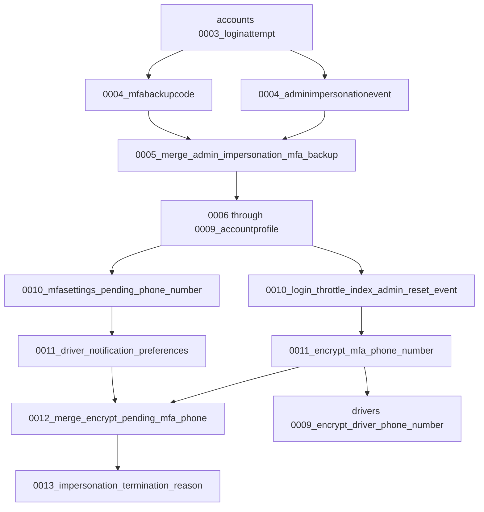

# Database migration workflow and audit

Reviewed against the Sprint 5 repository on October 20, 2026.

## Current graph

Django orders migrations by their dependencies, not by filename numbers alone.
Parallel migrations with the same numeric prefix are supported. Preserve
existing filenames because shared databases record their complete names.



The diagram abbreviates other dependencies. `drivers.0009` also depends on
`drivers.0008`; notification preferences depend on `drivers.0008`.
`about_page.0001` copies legacy About records from `drivers.0002` before
`drivers.0003` removes the old model. That temporary historical model is
intentional; deleting its migration would break fresh installation.

There is one current leaf in each application:

- `accounts.0013_impersonation_termination_reason`
- `drivers.0009_encrypt_driver_phone_number`
- `about_page.0002_add_sprint3_release`

No renumbering or squashing is needed to make these branches converge.

## Verification and its limits

`accounts.tests.test_migration_upgrades` uses isolated, in-memory SQLite
databases and historical models to exercise both Sprint 5 upgrade paths:

- Notification branch: existing verified and pending plaintext MFA numbers.
- Security branch: existing verified MFA numbers already converted to encryption.

Both paths must preserve Driver and MFA phone values, encrypt their database
columns, and reach the latest migration state without pending operations.
Test database creation also exercises installation from an empty SQLite schema.
These tests build historical states from empty databases and move forward;
they do not roll back the normal test database or the local development file.

CI checks for missing model migrations, explicitly migrates a fresh SQLite
database, verifies its applied state, and runs the tests. A valid graph does
not prove shared MySQL data is clean. MySQL schema alterations and real shared
data still require a separate integration check; this audit does not claim
that the shared RDS database was inspected or modified.

## After pulling changes

From `backend`, with the virtual environment active and the intended database
configured:

```text
python manage.py check --database default
python manage.py showmigrations accounts drivers about_page --plan
python manage.py migrate --plan
python manage.py migrate
python manage.py migrate --check
```

Review the selected database before applying changes. Use a stable
`FIELD_ENCRYPTION_KEY` (or its `TOTP_ENCRYPTION_KEY` fallback) before the phone
encryption migrations run. Retain the key with the database backup: changing
the key later makes existing encrypted values unreadable.

## Before adding migrations

1. Update your feature branch with current `main`.
2. Review model changes and coordinate with teammates working on the same app.
3. Run `python manage.py makemigrations` and inspect the generated operations.
4. Review `python manage.py migrate --plan` before applying it.
5. Verify the relevant data preservation and upgrade behavior.
6. Commit model changes and their migrations together.

If Django reports multiple leaves, inspect their operations before using
`makemigrations --merge`. A dependency-only merge is sufficient only when the
operations are compatible. Overlapping field changes can need an explicit
follow-up operation, as the encrypted pending-number field did in `0012`.

## Recovering an inconsistent local database

For disposable SQLite development data, stop the backend, confirm SQLite is
selected, and preserve the database before starting a fresh one. From `backend`:

```powershell
# Windows PowerShell; choose a backup name that does not already exist.
Move-Item -LiteralPath db.sqlite3 -Destination db.before-migration-recovery.sqlite3
python manage.py migrate
```

```bash
# macOS/Linux; choose a backup name that does not already exist.
mv -i db.sqlite3 db.before-migration-recovery.sqlite3
python manage.py migrate
```

Keep the backup until required data has been recovered. Recreate demo data with
the documented local development procedure. Never use this local reset recipe
for MySQL or production.

For shared MySQL, preserve the database and capture the full error,
`showmigrations`, and `migrate --plan` before coordinating a repair. Do not
manually delete `django_migrations` rows, rename applied migrations, drop shared
tables, or use `--fake` simply to suppress an error. `--fake` is appropriate
only when the actual schema and migration state have been independently checked
and a specific repair plan calls for it.

The phone-encryption data migrations use a no-op reverse operation. Rolling
back their migration record does not decrypt data. Do not downgrade across
those migrations as a recovery shortcut.

The audit also encountered a SQLite missing-column error while attempting to
rewind both parallel Sprint 5 paths together. Forward upgrade tests are the
supported verification here; rollback across the merge is not verified and
must not be treated as a recovery procedure.
