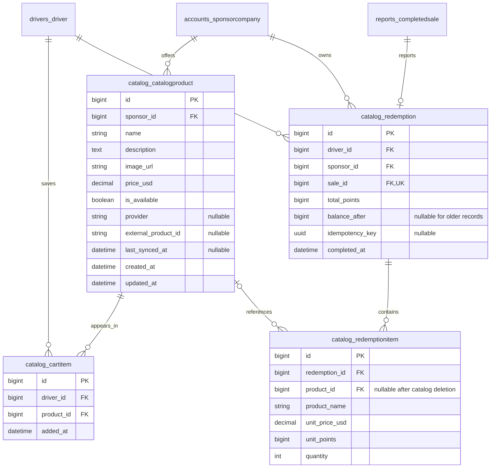

# Sprint 7 commerce schema supplement

This diagram describes Django models/migrations in this branch, not a verified
AWS schema export. The older full ERD remains a historical baseline.

Composite unique constraints: cart `(driver_id, product_id)`, imported product
`(sponsor_id, provider, external_product_id)`, and redemption
`(driver_id, idempotency_key)`. Manual product/provider identifiers are both null;
imported identifiers must be populated together. A nullable idempotency key
allows older/non-keyed redemptions. Quantities currently equal one in checkout.

Receipt names, USD prices, point costs, and completion time are snapshots.
Reporting money comes from `CompletedSale`, whose project share is exactly 1%
of gross USD. Product price changes never reprice historical receipts or sales.
Point costs for current products remain derived from Sponsor conversion rates;
they are stored only when a redemption is recorded. Freshness flags and signed
review tokens are computed, not new database columns. Review tokens bind the
cart and pricing state and expire after ten minutes.

Migration history converges at `catalog.0005_merge_provider_redemption`, retaining
both published `0002` paths, the existing `0003_merge_cart_provider`, and the
redemption `0003`/`0004` migrations. Repeated numeric prefixes are valid because
Django orders migrations by dependencies, not by prefix alone.
